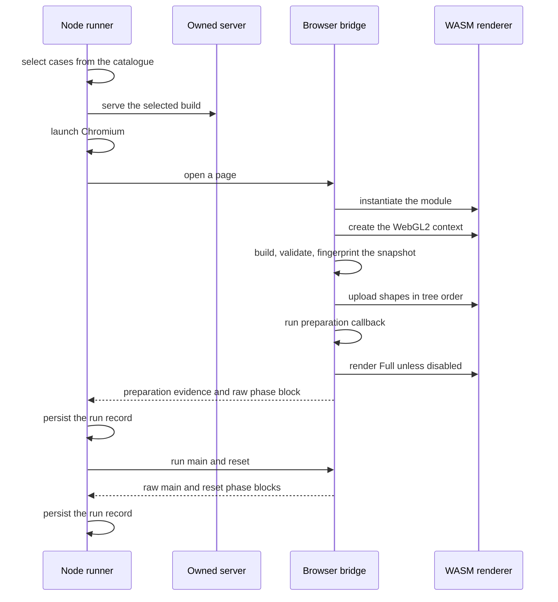
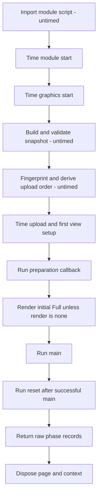

# WASM renderer benchmarks

The renderer benchmark suite measures the Penpot WebAssembly (WASM) renderer in
Chromium. Scenes describe shapes; cases describe the work to perform on them.
The suite records setup, rendering, pan and zoom durations and compares runs
with different renderer builds. [How to run](#how-to-run) gives the commands.

The suite has three parts:

1. A Node runner controls the experiment. It prepares or reuses a build, selects
   cases, serves the browser code, launches Chromium, schedules attempts, saves
   results, and prints reports. An attempt is one execution of a case.
2. The browser creates the renderer and graphics context, constructs the scene
   snapshot, uploads its shapes, performs the work, and records durations.
3. The reporting code computes statistics from saved records in Node or the
   browser without loading the renderer.

## Contents

- [Main concepts](#main-concepts)
- [Architecture](#architecture)
- [Workloads](#workloads)
- [Renderer commands](#renderer-commands)
- [Measurement](#measurement)
- [Results and reports](#results-and-reports)
- [A/B feature experiments](#ab-feature-experiments)
- [How to run](#how-to-run)
- [Unit tests](#unit-tests)
- [Scope and limitations](#scope-and-limitations)
- [Repository map](#repository-map)
- [Further reading](#further-reading)

## Main concepts

### Workload

- **Renderer**: the Rust Skia renderer compiled to WebAssembly. It owns shape
  storage, tiles, caches, and the WebGL2 graphics state for one canvas.
- **Module**: one instantiated copy of the renderer. The browser creates a
  module per prepared page and releases it with the page.
- **Graphics context**: the WebGL2 context and renderer state bound to one
  canvas. A benchmark _case_ can use either a fresh or a reused context.
- **Scene**: a recipe that produces a starting set of shapes. A scene has an
  id, a closed parameter schema, and a builder function. This function is given
  a random seed and returns a _snapshot_. Scenes can be **procedural**, or
  **captured**. The former build shapes from code, parameters, and a random
  seed, whereas the latter render a page exported from Penpot.
- **Scene snapshot**: the concrete shapes a run renders. This is only static
  data, camera movement and other interactions belong to a **case**.
- **Master seed**: the initial seed for the run, supplied on the command line.
  It defaults to 42 and accepts a 32-bit unsigned integer.
- **Seed**: a 32-bit integer derived from the master seed, scene id, and
  canonical parameters. The seed makes a scene reproducible. Load, pan, and
  zoom cases for the same scene and parameters share one seed.
- **Scene builder**: the construction API used inside a scene. It provides basic
  shapes (`rect`, `path`, `circle`, `frame`, `group`, and `bool`) constructors,
  and a (hopefully) self-explanatory API.
- **Reference**: a label that a scene attaches to a shape during construction.
  A case operation uses references to find shapes it needs.
- **Case**: a scene plus its execution settings: parameters, base view, context
  policy, completion rule, optional operation settings, and a run function. A
  case is the unit that is measured.
- **Operation**: the function that performs a case's work during one attempt.
  It receives a command context with the case data, scene snapshot, current
  view, and hooks. Standard operations load, pan, and zoom.
- **View**: the camera's zoom `:scale` and offsets `:x` and `:y`.
  Optional `:viewport` settings give the canvas width, height, and device pixel
  ratio, the number of drawing-buffer pixels per CSS pixel along each dimension.
- **Hook**: a function supplied through `:hooks` for clock readings,
  scheduling, view updates, rendering, or checking whether work may continue.
- **Case descriptor**: What gets sent to the browser. It contains the case id,
  scene, derived seed, parameters, view, context policy, completion rule, batch
  size, preparation settings, and operation settings. Any functions are removed.
- **Catalogue**: the compiled list of case descriptors and scene declarations
  for one build. Node reads the catalogue to select cases. The browser executor
  contains the same declarations and looks up the run function by case id.
- **Fingerprint**: SHA-256 digest of the validated starting snapshot. A
  comparison checks it to establish equal starting scene content.

### Execution

- **Build**: one compiled renderer plus the matching catalogue and browser
  executor. A build id ties the three outputs together, and the runner rejects
  a mismatch.
- **Retained build**: a ready build that the suite stores under the managed
  build directory for reuse in later runs.
- **Fresh case**: a case with `:context :fresh`. Each attempt gets a new page,
  module, graphics context, and upload.
- **Warm case**: a case with `:context :reuse`. One page, module, graphics
  context, snapshot, and upload serve all attempts of the case.
- **Preparation**: setup for one graphics context. It covers module
  instantiation, WebGL2 context creation, scene build, snapshot validation,
  fingerprinting, upload-order derivation, and upload. It then runs the optional
  preparation callback and drains to `Full` unless the case declares
  `:preparation {:render :none}`. One page owns one preparation.
- **Attempt**: one execution of a case against a preparation. It records an
  `:attempt-id`, one outcome, main and optional reset phase blocks, and failure
  or partial evidence. A failed attempt still consumes its allocated slot.
- **Warmup**: an attempt that runs the case before measured attempts to warm
  caches and stabilize the page. The run records warmups but excludes them from
  statistics.
- **Repetition**: a measured attempt. A case has a fixed number of repetitions
  chosen before the run.
- **Run**: a set of attempts over selected cases. A run owns the browser
  processes it starts, fixes warmup and repetition counts, records failures in
  chronological order, and performs no hidden retries.
- **Run record**: the saved evidence for one run: plan, build and environment
  provenance, quantity descriptions, preparations, attempts with their phase
  histories, failures, terminal case outcomes, remaining slots, and termination.
  The runner stores it as a data file validated by a schema.
- **Bridge**: the object that runs in the browser, receives plain requests from
  Node, owns the page's renderer context, runs preparations and attempts, and
  returns plain results.
- **Runner**: the Node command line interface that builds or reuses a build,
  selects cases, serves the build, launches Chromium, runs attempts, saves
  records, and prints reports.
- **Browser executor**: the compiled page and JavaScript that perform
  preparation and case operations. Its bridge exposes the operations that Node
  can request.
- **Measurement**: a numeric result for a quantity such as elapsed duration.
  The suite measures module start, graphics start, upload, first render, and
  camera movement separately.
- **Metric**: the name of a measured quantity. A command event records its raw
  numeric values in a vector. A saved run supplies a `:unit` and an optional
  `:description` for each metric type. It stores no statistic or reduction.
- **Metric key**: `[phase scope metric-type]`. Scope is the command that recorded
  the metric or `:global` for every command with that type in the phase.
- **Observation**: one eligible phase execution's sum for one metric key. Inner
  calls, slices, and loop repetitions stay within that execution and do not add
  observations. Warmups and failed attempts supply none.
- **Slice**: a trace entry for one renderer call: timestamp, flags, frame type,
  and duration. Slices describe the work within an attempt.
- **Trace**: details of the work, including individual renderer calls,
  cached previews, requested waits, and observed durations.
- **Clock reading**: a time in milliseconds from the clock's origin. Subtracting
  two readings from that clock gives an elapsed duration.
- **Endpoint**: the clock reading at the end of the measured work. The renderer
  endpoint is the reading immediately after a renderer call returns.
- **Render drain**: repeated renderer calls until one returns `Full`. Partial
  completion schedules another call on the next animation frame.
- **Cached preview**: one render from cached tiles after a view update.
- **Camera session**: camera start, view updates with cached previews, a settling
  wait, camera end, and the final render drain.
- **Active interval**: the part of a camera session from camera start through
  the last cached preview and its guard check, or an explicit pause that follows
  the preview.
- **Settling wait**: the requested pause after the active interval and before
  ending the interaction. The observed wait includes scheduling delays.
- **Camera finalization**: the interval from immediately before ending the
  interaction through the renderer call that returns `Full`.
- **Frame type**: the completion signal returned by one renderer call. `None`
  means no frame; `Partial` means visible work remains; `Full` means the
  renderer finished the current request; `ViewportReady` means the visible
  viewport was submitted while work outside the viewport may remain.
- **Tile**: a unit of renderer work with a fixed size. A logical tile covers
  512 document units. The renderer caches rendered tiles in a texture atlas.
- **Atlas**: a GPU texture that stores many tiles or a document-space preview.
  Atlases let warm pan and zoom present cached pixels before new tiles finish.

### Command execution

- **Renderer command**: a function that accepts a command context or its Promise
  and returns a Promise of the next context. The base function uses the declared
  name, such as `pan`. The measured function adds `*`, such as `pan*`, and records
  an event for its work.
- **Command context**: the map with keys `:case`, `:scene`, `:view`, and `:hooks`.
  It carries the case descriptor, prepared scene snapshot, current view, and
  hooks.
- **Command body**: the work declared by `defcommand`. A synchronous body
  returns the next context. An asynchronous body completes through callbacks
  named by its declaration.
- **Composite command**: a command that combines calls to other commands.
  A declaration with `:measured-variant false` defines its base function and
  collects events from the measured commands it calls.
- **Command execution**: one call to `commands/execute`, which runs a function
  from one command context to the next and records measured calls in completion
  order.
- **Event**: the record for one measured command call. It contains the command
  name, vectors of raw metric values, and an optional trace.
- **Guard**: the `:check` hook. A return authorizes work; an error rejects it.
  The renderer owner is the execution authorized to use the renderer. The guard
  can report cancellation, deadline expiry, context loss, or replacement of
  that owner.
- **Completion callback**: `complete` or `fail` in an asynchronous command body.
  The first call determines the outcome: `complete` supplies the next context
  and optional measurements; `fail` supplies a cause.

### Results

- **Report**: the statistics and tables computed from one or more run records.
  Reports run in Node or the browser and do not load the renderer.
- **Comparison**: an offline analysis of two saved run records. It pairs cases,
  checks compatibility, and reports changes for each metric key with intervals.
- **A/B comparison**: a comparison of two runs that differ by one renderer
  feature. The feature is off in one run and on in the other.
- **Permission**: In principle, only run records with equal builds and equal
  scenes are comparable. Because one sometimes needs to override this strict
  requirement, permissions allow build environment or scene differences in a
  comparison.
- **Termination**: the final state of a run: completed, failed, incomplete, or
  interrupted.

### Feature experiments

- **Feature**: a switch at compile time in the renderer's Cargo manifest.
- **Feature configuration**: the set of Cargo features enabled for one renderer
  build.
- **Feature comparison**: all on and off combinations of the requested features.
  $N$ requested features produce $2^N$ configurations.
- **Edge**: two configurations that differ in exactly one feature, compared from
  the configuration with the feature off to the configuration with the feature
  on. A comparison with $N$ features has $N 2^{N-1}$ edges.
- **Edge comparison**: the comparison record for one edge, stored with the
  feature comparison.
- **Feature-comparison record**: the saved plan, configurations, runs, edges,
  failures, and termination for one A/B experiment.

## Architecture

### Components

The Node runner owns everything outside the page:

- it prepares or loads a build;
- it reads the compiled catalogue and selects cases;
- it serves the selected build from a server on `127.0.0.1`;
- it launches Chromium and creates pages;
- it schedules warmups and measured attempts;
- it records preparations, attempts, failures, and termination;
- it writes the run record as work progresses;
- it prints a final report.

The browser bridge owns everything inside the page:

- it validates a request before assigning the page to that work;
- it imports the renderer module and creates the canvas and WebGL2 context;
- it builds, validates, fingerprints, orders, and uploads the scene;
- it carries each phase's returned context into the next phase or attempt;
- it runs the case operation and records the requested measurements;
- it returns plain data and disposes the context when asked.

The shared reporting code owns analysis:

- it normalizes run records into summaries;
- it computes statistics and intervals for each metric;
- it pairs saved cases and checks compatibility;
- it formats run summaries, comparisons, and feature-comparison edge reports;
- it imports no browser, server, or renderer code.

### End-to-end path



The Node runner saves the initial plan before it starts a browser, and updates
the run record after each preparation and attempt, and at termination. Reports
use these saved records.

### Builds and catalogues

A build has three matching outputs:

- the renderer module;
- the case catalogue compiled for Node;
- the browser executor and its page.

Build preparation compiles the renderer in release mode with Cargo, then compiles
the catalogue and browser executor with the same build id. The runner checks
the id before case collection and when a page starts, and rejects a mismatch.

An ordinary measurement build uses the renderer's default Cargo feature set. A
feature experiment may enable selected functional features. Both kinds of
measurement build should exclude diagnostic features such as `stats`, `profile`,
`profile-macros`, and `profile-raf`. The build checks that we are in release
mode, the optimization level, and disabled profiling marks.

The build record captures a fixed list of environment values supplied to Cargo,
including compiler, target, and Emscripten settings. These values provide
provenance for interpreting a run. Reproducing a build also requires its other
environment settings and dependencies.

Builds are saved under `target/performance/render-wasm/builds/<id>/`. The
manifest records the build id, status, functional settings, Git provenance, and
build facts. An experiment run can select a retained build with `--build <id>`,
and `run` prepares a new build when it omits `--build`.

`build` and a run that prepares its build accept `--features`,
`--[no-]default-features`, and `--build-timeout-ms`. A run with `--build` reuses
the retained build and rejects those preparation options.

Run one build preparation at a time in a checkout and keep renderer watchers
stopped until it finishes. The renderer build lock covers Cargo compilation
and copying the renderer files. The build script releases that lock before
ClojureScript compilation.

### Browser host

The runner serves the selected build directory from `127.0.0.1` on an allocated
port.

The runner launches headless Chromium with Playwright and owns the browser
process it starts. Cases run serially. A fresh case gets a new page and context
for each preparation. A warm case keeps one page and context for all of its
attempts.

Before cases run, `--startup-timeout-ms` bounds Git provenance, server startup,
and the initial browser launch. Each case then gets one absolute `--timeout-ms`
deadline. The deadline covers the case's page setup, preparation, warmups,
repetitions, reset, and screenshot diagnostics. It does not restart for a phase,
attempt, or browser replacement. Work on a reused preparation keeps its original
case deadline; a request timeout can only tighten that deadline. A browser
launched after a failed case uses the next case's remaining deadline.

When a page stalls past its deadline, Node stops the browser process and records
the failure. The browser bridge also checks for context loss, expired deadlines,
and work associated with a superseded renderer owner before and after
asynchronous work. A browser thread occupied by synchronous work relies on the
Node deadline to stop it. The runner persists each delivered preparation and
attempt. It does not stream browser-local records and cannot recover in-flight
data when a blocked browser cannot return; records delivered before the block
remain saved.

Clean-up closes the page, then the browser, then the server. The runner deletes
a build selected with `--remove` only after the final run record is saved.

## Workloads

### Declaring a scene

A scene declaration names an id, a description, a closed parameter schema, and a
builder function. The builder runs inside a seeded scope. Random values come
from one generator owned by that scope, so the same recipe, parameters, and seed
produce the same snapshot.

```clojure
(defscene :rects
  {:description "Seeded rectangles with translucent fills and centered strokes"
   :params-schema schema:params}
  [params]
  (scene {:seed (:seed params)
          :root {:x 0 :y 0 :width (:width params) :height (:height params)}
          :defaults {:rect {:x (gen-int 0 (:width params))
                            :y (gen-int 0 (:height params))
                            :width (gen-int 20 100)
                            :height (gen-int 20 100)
                            :fills (gen-vector (gen-fill))}}}
    (doseq [_ (range (:count params))]
      (rect))))
```

Each scene has one construction scope. Starting another scene inside it raises
an error. Ordinary `let`, `doseq`, and functions defined outside the scope work
inside the body. Each shape constructor accepts an optional label
or a label plus attributes. Attributes override generated defaults by key.
Labels must be keywords or vectors and must be unique within the snapshot.

Containers follow the same pattern:

- `frame` keeps the supplied `:x`, `:y`, `:width`, and `:height`.
- `group` derives bounds from its children. A masked group uses its first child
  as the mask.
- `bool` derives content and bounds from its children with the standard path
  engine. It requires a boolean operation type. Frame children raise a
  construction error.

### Declaring a case

For a scene named `:rects`, case ids start with `:rects/`. The `defcase` form
derives the scene from that keyword namespace and attaches the run function.

```clojure
(defcase :rects/pan
  {:params default-params
   :view {:scale 1 :x 0 :y 0}
   :context :reuse
   :reset (fn [rtx]
            (camera/pan rtx {:steps 20 :dx -200 :dy 0 :settle-ms 100}))}
   [rtx]
   (camera/pan* rtx {:steps 20 :dx 200 :dy 0 :settle-ms 100}))
```

The case declares:

- `:params`: scene parameters. Collection validates them against the scene's
  closed schema.
- `:view`: the starting camera, with an optional viewport override. The default
  viewport is 1920 by 1080 at device pixel ratio 2.
- `:context`: `:fresh` creates a page, module, and context per attempt.
  `:reuse` keeps one page, module, context, snapshot, and upload for all
  attempts of the case.
- `:preparation`: an optional `:callback` function runs after upload and returns
  the next context or its Promise. Preparation then renders Full by default.
  `:render :none` completes preparation after the callback for cold-render cases.
- `:reset`: an optional function that receives the context after successful
  main execution and returns the next context or its Promise. Reset runs after
  every successful main, including warmups and the final attempt.

Commands receive workload arguments from the case body. The callback, main body,
and reset share the command context and can each call measured commands.

### Case collection and seeds

Node collects cases from the compiled catalogue. Collection loads every
declaration, validates every scene and case, derives the scene seed, selects
the case's data fields, and checks that the descriptor survives a serialization
round trip. Shape construction, browser startup, and renderer initialization
take place during execution.

The local registry keeps the main, reset, and preparation callback functions.
The descriptor carries the declared preparation data. The browser resolves the
functions from its registry using the case id.

The scene seed depends only on the master seed, the scene id, and the canonical
parameters. These inputs give load, pan, and zoom cases the same starting
content across case bodies, collection orders, attempt counts, and feature
configurations. They also give A/B configurations matching scene content.

A filter selects cases by a substring of the case id. An empty selection is an
error. Declarations outside the filter are still validated.

### Snapshots and upload order

The snapshot contract requires the canonical root frame, shape ids that match
their object keys, consistent child and parent links, a tree that reaches every
shape from the root, and references that point at present shapes. Validation
runs before any timer starts.

The browser derives upload order from the snapshot. The root comes first, then
descendants in the order of each shape's
child list. The browser computes the order and the fingerprint before the upload
clock starts. The upload uses the same batch serializer as the editor, with
structure, fill, and stroke data batched and path and SVG attributes handled per
shape.

### Some example scenes

| Scene   | Content                                                                 | Cases           |
| ------- | ----------------------------------------------------------------------- | --------------- |
| `rects` | 1000 rectangles with random size, translucent fills, strokes, and radii | load, pan, zoom |
| `paths` | 1000 curved paths with fills and strokes                                | load, pan, zoom |
| `plus`  | 1000 plus signs made from two open line subpaths                        | load, pan, zoom |
| `masks` | 24 masked groups, each with a circle mask and 8 striped rectangles      | load, pan, zoom |

Scene recipes supply canonical geometry for rendering and camera workloads.
Camera sessions submit view updates and wait for settling before their final
render. Each case declares its sequence, arguments, and reset behavior in code.

## Renderer commands

A renderer command accepts a command context or its Promise and returns a
Promise of the next context. The command context has four fields:

| Field | Meaning |
| --- | --- |
| `:case` | Case descriptor, including the case id. |
| `:scene` | Prepared starting snapshot with concrete shapes and references. |
| `:view` | Current zoom scale, camera offsets, and optional viewport settings. |
| `:hooks` | Functions for clocks, scheduling, rendering, view changes, and the execution guard. |

The `:scene` field describes the starting snapshot. Commands return view changes
through `:view` and apply renderer work through hooks. Every command context
supplies `:now`, `:check`, `:frame`, `:sleep`, `:render`, `:render-sync`,
`:render-from-cache`, `:set-view`, `:set-view-start`, and `:set-view-end` as
functions. The `:now` hook returns a clock reading in milliseconds.
The `:check` guard authorizes work by returning and reports cancellation,
deadline expiry, context loss, or a superseded owner
by throwing an error. The owner is the execution authorized to use the renderer.
Returned contexts retain the execution's `:check` guard; replacing it rejects
completion.

### Declaring a command

`defcommand` defines two functions from one body. The base function runs the
work; the function with a `*` suffix also records a measurement event. Measured
functions require an active command execution. Both functions resolve their
incoming context before running the body. A synchronous body
returns the next command context.

```clojure
(ns example.renderer-commands
  (:require
   [benches.render-wasm.runtime.camera :as camera]
   [benches.render-wasm.runtime.commands :as commands :refer [defcommand]]
   [benches.render-wasm.runtime.protocol :as protocol]))

(defcommand render-sync
  "Renders the prepared scene synchronously."
  [rtx]
  ((get-in rtx [:hooks :render-sync]))
  rtx)
```

`:pre` conditions validate arguments before work and timing in every build.
Input resolution, context validation, and argument validation precede the start
clock reading. Context validation checks the complete set of hooks. Output
validation and event recording follow the endpoint.

The body duration is

\[
\Delta t = t_{\mathrm{end}} - t_{\mathrm{start}},
\]

where both clock readings use milliseconds from the same origin. A synchronous
command captures the endpoint immediately after its body returns. An
asynchronous command supplies an endpoint or captures it when `complete` runs.

### Asynchronous completion

The option `:async [complete fail]` supplies two completion callbacks to the
body. Their names belong to the declaration; the public command arguments stay
the same. The first callback call determines the outcome:

- `(complete next-rtx)` succeeds with the next command context and captures the
  endpoint at that call.
- `(complete next-rtx evidence)` succeeds with an explicit endpoint and raw
  measurements when `evidence` supplies them.
- `(fail cause)` rejects the command with its cause and available partial trace.

Successful completion requires a call to `complete`. A returned Promise forwards
its rejection to `fail`. The execution records diagnostics for repeated
completion calls while it is active. Its guard checks authorization at
completion, and the measured command records its event after output validation.

The optional completion map has these fields:

| Field | Meaning |
| --- | --- |
| `:end-ms` | Clock reading at the end of the work, using the same clock origin as the start. |
| `:metrics` | Namespaced metric keywords mapped to nonempty vectors of raw numbers. |
| `:trace` | Details of the work, such as traces of render calls and requested waits. |

The command supplies `:command/elapsed`, its body duration in milliseconds.
`:metrics` supplies additional quantities. Command events preserve zero,
negative, `NaN`, and infinite numeric values as raw measurements.

Camera completion illustrates the callback interface:

```clojure
(defcommand pan
  "Moves the view and completes when rendering reaches Full."
  {:async [complete fail]}
  [rtx {:keys [dx dy steps settle-ms]}]
  (let [target (-> (:view rtx)
                   (update :x + dx)
                   (update :y + dy))]
    (-> (protocol/start-camera! rtx {:settle-ms settle-ms})
        (protocol/animate-view! {:to target :steps steps})
        (protocol/finish-camera!)
        (.then (fn [trace]
                 (complete (assoc rtx :view target)
                           {:end-ms (:end-ms trace)
                            :metrics {:renderer/call-elapsed
                                      (mapv :duration-ms (:slices trace))}
                            :trace trace})))
        (.catch fail))))
```

The final renderer call can return before the Promise callback runs. The
`:end-ms` field carries that renderer endpoint through the scheduling delay.
For example, renderer work lasting 7 ms followed by a 500 ms callback delay
still supplies a renderer duration of 7 ms. A clock reading in the later
callback would measure 507 ms.

The provided `camera/pan` and `camera/pan*` commands accept explicit `:dx`, `:dy`,
`:steps`, and `:settle-ms`. They submit interpolated views on animation frames,
draw cached previews, wait for settling, and finish rendering to `Full`. They
resolve to the context with the final view. The measured function records:

| Metric | Values in one event, in milliseconds |
| --- | --- |
| `:command/elapsed` | One duration from the start of the body through the renderer endpoint. |
| `:renderer/call-elapsed` | One duration per renderer call in the final drain. |
| `:renderer/cache-call-elapsed` | One duration per cached render call. |
| `:camera/finalization-to-full` | One duration from before ending the interaction through the renderer endpoint. |

Its trace also contains individual render calls, view-update durations, waits,
and the final `:end-ms`. Each vector preserves the call order within its quantity.

### Composition and execution

A composite combines commands. `:measured-variant false` defines its base
function and selects measurements through the calls in its body:

```clojure
(defcommand selected-pans
  {:measured-variant false}
  [rtx]
  (-> rtx
      (camera/pan* {:dx 10 :dy 0 :steps 2 :settle-ms 5})
      (camera/pan {:dx 0 :dy 5 :steps 2 :settle-ms 5})
      (camera/pan* {:dx -10 :dy 0 :steps 2 :settle-ms 5})))
```

All three calls update the view and renderer. The first and third record
events. Command functions resolve incoming Promises, so threading passes each
updated context to the next command.

A command execution runs a function from one command context to the next,
authorizes its work, and collects events in completion order. Given a prepared
command context `rtx`:

```clojure
(commands/execute rtx selected-pans)
```

The returned Promise resolves to an outcome. A successful outcome contains
`:outcome :completed`, the next `:context`, and ordered `:events`. A failed
outcome contains `:outcome :failed`, `:error`, and the events recorded before
failure. Existing Errors retain their identity and partial trace. Other thrown
values become Errors with the original value in `:thrown`. An active execution
can also record repeated completion calls in `:diagnostics`.

An event has this shape:

```clojure
{:command :benches.render-wasm.runtime.camera/pan
 :metrics {:command/elapsed [74]
           :renderer/call-elapsed [7 7]
           :renderer/cache-call-elapsed [2 2]
           :camera/finalization-to-full [33]}
 :trace {:end-ms 74}}
```

One event represents one measured command call. Its metric vectors describe
the individual values that call produced. The command execution owns this
history; its guard authorizes work for that execution. Pass the resulting
context to `commands/execute` to start another command execution.

### Case phases

The browser executes preparation, main, and reset through the command executor.
Preparation builds and uploads the scene, runs its optional callback once, and
renders Full unless the case declares `:preparation {:render :none}`. A fresh
context prepares once for its attempt; a reused context prepares once for its
case. Each phase passes its returned context to the next phase.

A successful preparation response contains its raw block in
`[:preparation :phases]`. A failed preparation returns its available blocks in
top-level `:phases`. An attempt response contains main and any declared reset
in `:phases`:

```clojure
{:phase :main
 :preparation-id "preparation-1"
 :outcome :completed
 :events [{:command :benches.render-wasm.runtime.camera/render-sync
           :metrics {:command/elapsed [7]}}]}
```

Each block retains ordered command events, raw numeric vectors, and any
completion diagnostics. A phase can complete with an empty event vector.
Initialization and upload durations stay in preparation `:diagnostics`.
Automatic initial rendering retains its raw trace under
`[:diagnostics :setup-render]`. Measured commands in the callback supply the
preparation block's selected events.

Reset runs after successful main. Its returned context supplies the next reused
attempt. A phase failure releases its owned context and returns the failed
block with earlier events and available traces. Completed preparation retains
its own evidence when main or reset fails. Any preparation, main, or reset
failure stops the case; the runner attempts no later slot. It disposes the
case's browser and starts the next case in a new browser when the run continues.

### Runtime code

[`runtime/commands.clj`](runtime/commands.clj) declares commands;
[`runtime/commands.cljs`](runtime/commands.cljs) executes them.
[`runtime/camera.cljs`](runtime/camera.cljs) defines rendering and camera
operations. [`runtime/protocol.cljs`](runtime/protocol.cljs) defines render
drains, camera sessions, hook contracts, and trace fields.

Case declarations such as [`scenes/rects.cljs`](scenes/rects.cljs) attach operation
bodies through [`declarations.cljc`](declarations.cljc). Node loads these
declarations and functions during catalogue collection. Renderer operations run
through the supplied hooks when the functions execute in the browser.
[`browser/bridge.cljs`](browser/bridge.cljs) constructs the runtime context for
case operations and prepares graphics contexts, snapshots, and uploads. Reused
cases carry their returned context into the next attempt; their reset function
controls restoration.

## Measurement

### Preparation and measurement boundaries

Each duration has a defined start and endpoint. Setup and diagnostics run
around the interval whose work they prepare or describe.

Work around those intervals includes:

- scene build, snapshot validation, and fingerprinting;
- upload order derivation;
- request and result serialization;
- validation, logging, and screenshots;
- module script import;
- the automatic initial Full render during preparation.

Preparation diagnostics time:

- module instantiation;
- graphics context creation and initial size synchronization;
- shape batch upload, including the loading lifecycle and first view setup;
- the automatic render drain to `Full`.

Measured commands record their own intervals during preparation, main, or reset.
For a camera command, this includes view updates, cached previews, settling,
ending the interaction, and the final drain.

### Lifecycle of a fresh load



The module script import is untimed because the browser loads it once per page.
Module instantiation starts a new renderer state. Graphics start creates the
WebGL2 context and synchronizes the drawing buffer. Upload covers the loading
lifecycle, batch serialization, and tile preparation. Each measured command
starts its clock immediately before its work.

### Warm interactions

A warm case owns one prepared page. Its main body starts from the context
returned by preparation or the preceding attempt's reset. A camera command runs
this session:

1. start the camera interaction;
2. for each view update, wait for the next animation frame, apply the view, and
   present cached pixels;
3. wait for the requested settling time;
4. end the camera interaction;
5. render until `Full`.

A pure pan can reuse cached textures while it updates which tiles are visible.
A zoom rebuilds and invalidates tile textures. Standard cases request a 100 ms
settling wait and record the requested and observed durations separately from
renderer calls. Camera finalization includes the call that ends the interaction;
the run also records that call's duration.

### Slices and metrics

The browser returns ordered events within each phase. Preparation diagnostics
retain `module-init-ms`, `graphics-init-ms`, and `upload-ms` separately.

A render drain retains these trace fields:

- `slices`: one record per renderer call with `timestamp`, `flags`,
  `frame-type`, and `duration-ms`;
- `viewport-ready-ms`: the first `ViewportReady` or `Full` completion from the
  drain origin;
- `full-ms`: the `Full` completion from the drain origin.

A camera command's trace contains the camera session and final drain:

- `cached-slices`: one record per gesture frame with `timestamp`,
  `duration-ms` for the cached preview call, and `view-and-preview-ms` for the
  view update plus preview call;
- `slices`: the final drain, with the same shape as a fresh drain;
- `interact-ms`: the whole camera session, from before the interaction starts
  through the final `Full`;
- `active-ms`: from before the interaction starts to after the last cached
  preview and its guard check, or after an explicit pause that follows it;
- `settling-requested-ms` and `settling-actual-ms`: the declared and observed
  settling waits;
- `set-view-end-ms`: elapsed time during the call that ends the interaction;
- `time-to-viewport-ready-ms` and `time-to-full-ms`: durations from camera
  finalization through the first `ViewportReady` or `Full`, and through `Full`,
  respectively;
- `last-input-to-full-ms`: from before the last view update to the endpoint of
  the renderer call that returns `Full`.

Both drains and camera sessions return `end-ms`, the clock reading immediately
after the final renderer call returns `Full`. Completion durations end at that
reading. Promise callbacks can run later as the browser schedules queued work.

Measured command events keep each metric's raw values in a vector. Repeated
commands produce separate events, including when they name the same metric.
Raw values preserve zero, negative, and non-finite measurements in the saved
record. Reports sum one metric type within one phase execution before computing
statistics; saved records contain no aggregates.

### Renderer completion

The renderer finishes in tile budgets. One renderer call returns a frame type,
and the caller continues while the renderer reports `Partial` or
`ViewportReady`. The drain completes when a call returns `Full`. `None` or an
unknown value fails the attempt.

| Value | Frame type      | Meaning                                                        |
| ----: | --------------- | -------------------------------------------------------------- |
|     0 | `None`          | no frame                                                       |
|     1 | `Partial`       | visible work remains                                           |
|     2 | `Full`          | the renderer finished the current request                      |
|     3 | `ViewportReady` | the visible viewport was submitted; work outside it may remain |

`Full` marks renderer submission of the completed request. Skia and WebGL queue
GPU work, and GPU execution and display follow their own schedules. A call
duration measures synchronous work on the calling thread, including any driver
stall. These clock readings describe work through the renderer return.

For scheduled calls, the browser passes the timestamp of the animation frame.
For immediate calls, it reads the clock. Each slice records its timestamp to
describe the call sequence.

### Graphics environment

The benchmark uses WebGL2 with `antialias=false`, `depth=true`, `stencil=true`,
`alpha=true`, and `preserveDrawingBuffer=true`. The default viewport is 1920 by
1080 at device pixel ratio 2. The preparation records the effective CSS size,
drawing-buffer size, device pixel ratio, context attributes, renderer and vendor
strings, and a software rendering warning.

Benchmarks run inside the Linux development container. Start it with
`./manage.sh run-devenv --gpu` to enable hardware access. This sets
`PENPOT_GPU=1`; the runner then selects ANGLE Vulkan, and `pnpm run render-bench`
starts Xvfb to supply the display that hardware rendering needs in the container.

`--require-gpu` makes `run` and `ab` require hardware WebGL2. The command first
checks for `PENPOT_GPU=1`, before builds, catalogue checks, or output allocation.
After each preparation returns, the runner checks its existing
`:effective-graphics` metadata before executing attempts. It requires WebGL2,
usable vendor and renderer identities, and `:software false`. A rejected
preparation aborts the run with exit 1 and stops later A/B configurations. The
record retains the preparation and graphics failure evidence, and leaves pending
attempt slots unattempted. The failure names the observed renderer and the
commands needed to enable GPU access. `ab --dry-run` skips these GPU checks.

Each preparation records the graphics identity of its own context. The run stores
the GPU policy and environment signal under diagnostics. Default runs allow
SwiftShader fallback and warn when they record software
rendering. Comparisons check effective graphics settings and resolved launch
arguments. Comparing hardware and software runs requires
`--allow-all-differences`.

## Results and reports

### Run record

A run record contains:

- the plan: selected case descriptors, warmup count, repetition count, and
  timeout policy (`:case-ms`);
- metadata: Git revision and dirty flag, build facts, environment, and diagnostics;
- the resolved analysis settings;
- saved quantity descriptions;
- preparations in chronological order;
- attempts in chronological order, each with its case, preparation,
  `:attempt-id`, warmup flag, outcome, main/reset phase blocks, and failure or
  partial evidence;
- terminal outcomes in `:case-outcomes`;
- remaining slots for each case;
- the termination reason.

A preparation records its case, warmup flag, setup diagnostics, phase history,
and any failure. A completed preparation also has its fingerprint and effective
graphics. An attempt records one outcome and its main and optional reset phase
blocks. A phase block retains ordered command events, raw metric vectors, and
optional completion diagnostics. Errors retain available phase evidence and
traces after a failure.

Each case has a terminal entry in `:case-outcomes` with `:outcome` set to
`:completed`, `:failed`, `:timed-out`, or `:interrupted` and an optional
`:failure`. Recording a terminal outcome closes the case: later preparation or
attempt evidence for that case is rejected.

### Failures and termination

A failed attempt still consumes its allocated slot. A fresh preparation failure
records a failed attempt and consumes the current slot. A reuse preparation
failure records no main or reset execution and consumes no main slot. Any
preparation, main, or reset failure stops the case for fresh and reuse alike,
so later slots stay unattempted. The runner disposes the failed case's browser
and starts the next case in a new browser when the run continues. A browser or
page failure follows the same case-stop rule. A failure to clean up the browser
for a failed case aborts later cases. The run fixes its attempt count before
execution and uses each allocated slot at most once.

A malformed delivered response follows the same slot rules. An attempt response
consumes the slot it invoked, keeps the valid phase prefix, and saves the raw
response as partial evidence. A malformed preparation response fails its
preparation; a fresh case still consumes the current slot.

A screenshot failure is diagnostic when it is an ordinary error. A deadline
expiry or interruption during the screenshot stops the case, while earlier
completed attempts remain saved.

A case that finishes all its slots without a measured command gets a failed
case outcome whose failure has `:reason :no-measurements`. The run then
terminates as failed or incomplete according to the remaining slots.

A run terminates in one of four states:

- **completed**: every allocated slot was attempted, every case outcome is
  `:completed`, and every case has at least one measurement.
- **failed**: every allocated slot was attempted and at least one attempt failed
  or one case outcome is not `:completed`.
- **incomplete**: slots remain because a case stopped early or a startup,
  browser, or storage failure prevented execution.
- **interrupted**: `SIGINT` or `SIGTERM` stopped the run.

The runner saves partial records before it exits. Use exit status to determine
whether the command completed successfully; saved records also describe work
that ended in failure.

### Summaries

A summary reports one entry per case and metric key
`[phase scope metric-type]`. The scope is the command that recorded the metric,
or `:global` for every command with that type in the phase. For each key, the
report sums the raw values of one metric type within each eligible phase
execution and computes statistics across those execution sums. It labels the
reduction `:statistic :sum`.

For each metric key, the report includes:

- the observed mean, median, minimum, maximum, sample standard deviation, and
  median absolute deviation;
- a bootstrap confidence interval for the median. The interval comes from
  repeated resampling of the observed execution sums;
- observed p95 and p99 values when the sample is large enough;
- counts for the valid, invalid, absent, failed, unattempted, and warmup
  categories, plus command invocation and raw-value counts;
- the saved quantity unit and optional description, and any validity
  diagnostics.

Statistical `n` is the valid count. Invocations count command events and
raw-values count all recorded numbers across eligible executions; neither is the
number of observations. Warmups and failed attempts are excluded. A failed
attempt excludes both its main and reset blocks. A completed preparation remains
eligible after a later main or reset failure. A fresh warmup preparation is
excluded; one reuse preparation supplies one observation, not one per attempt.

A finite zero is valid. Negative and non-finite raw values remain in the saved
record but invalidate the dependent execution sum and aggregate; independent
metric keys remain usable. Unknown or malformed quantity metadata appears as a
diagnostic and leaves that key without usable statistics. A phase can complete
with no events. Preparation-only and reset-only measured cases are valid. A
case that finishes all its slots without any measured command gets a failed
case outcome with `:reason :no-measurements`; the run is failed when every slot
was attempted and incomplete when slots remain.

The case report also counts actual preparation, main, and reset executions.
Completed and failed counts use each execution's own outcome, and a separate
count records warmup executions. These phase counts do not filter by attempt
eligibility. A completed main block from an attempt whose reset failed still
appears in the main phase counts but supplies no observation.

The default analysis settings are:

| Setting     | Default      |
| ----------- | ------------ |
| Draws       | 2000         |
| Seed        | `0x70656e70` |
| Confidence  | 0.95         |
| Minimum CI  | 10           |
| Minimum p95 | 100          |
| Minimum p99 | 500          |

The run records draw count, seed, confidence, and minimum counts, and a report
can override them at analysis time. An estimate that cannot be computed keeps a
reason and, when applicable, the minimum count it needs.

The intervals are exploratory and conditional on available executions.
Incomplete and timed-out cases can select which observations survive. Attempts
within one run share evolving caches and can have dependent durations. Repeated
whole runs provide evidence about reproducibility across those cache conditions.

### Comparisons

A comparison pairs saved cases by identical case id unless `--cases A,B`
selects one explicit baseline, candidate pair. The CLI checks the selector
syntax before it loads either record, then resolves each selector by saved case
id or exact name.

By default, a comparison requires equal:

- scene identity, scene seed, and scene parameters;
- starting-snapshot fingerprints;
- view, context policy, completion rule, batch size, preparation settings, and
  operation settings;
- effective graphics settings and runtime environment;
- build mode, effective features, instrumentation settings, and recorded build
  environment;
- warmup count, timeout policy (`:case-ms`), and saved quantity units.

Comparison pairs metric keys `[phase scope metric-type]`. Quantity description
text does not affect compatibility; changed prose is not a difference. Unknown
or malformed quantity metadata appears in the per-side report diagnostics and
leaves that key without usable statistics.

Git revision, dirty state, run ids, timestamps, and saved analysis defaults
provide provenance for interpreting the paired cases.

The comparison reports absolute and percentage median changes between execution
sums, with a bootstrap interval for each change. A zero baseline suppresses a
percentage change. The comparison leaves a metric key with differing quantity
units or incomplete quantity evidence out unless the all-differences
permission allows its valid raw values.

### Comparison permissions

The comparison records every compatibility difference. A permission acknowledges
a class of differences and labels each acknowledged
mismatch with the rule that allowed it.

- `--allow-build-differences` acknowledges recorded build settings, effective
  features, instrumentation, and the recorded build environment. Runtime
  environment, graphics, operation settings, and saved quantity units stay
  strict.
- `--allow-scene-differences` acknowledges scene identity, scene seed, scene
  parameters, and differences in fingerprint content. Execution settings stay
  strict. Missing or varying fingerprint evidence still needs the
  all-differences permission.
- `--allow-all-differences` acknowledges every compatibility difference,
  including mixed quantity units. The report compares valid raw execution sums
  in their recorded units. Record validation and measurement validity still
  govern the analysis.

Build and scene permissions combine by union. All-differences includes both.
A report shows the selected permissions, every recorded difference, and the
rule that acknowledged it. Exit status reports execution and compatibility
checks; the estimates describe the observed timing differences.

## A/B feature experiments

An A/B experiment answers one question: how do the selected cases behave when a
renderer feature is off versus on, with everything else held constant?

The `ab` command takes the requested features, plans the configurations, builds
every configuration, runs every configuration, and compares every edge: a pair
of configurations that differ by one feature.

### Planning

A feature configuration is a set of enabled Cargo features. The planner:

1. normalizes the requested names by trimming, deduplicating, and sorting them;
2. validates them against the renderer manifest with Cargo metadata;
3. requires an empty Cargo default feature set, so each configuration states
   its features explicitly;
4. rejects diagnostic features used for profiling or statistics;
5. orders the configurations in reflected Gray order, so adjacent
   configurations differ by one feature, with the first requested feature as the
   most significant bit;
6. emits every pair of configurations that differ in exactly one feature, from
   the configuration with that feature off to the configuration with it on.

The command requires at least one requested feature. For $N$ features, the
comparison has $2^N$ configurations and $N 2^{N-1}$ edges. The planner
compares each edge once, in the direction from off to on. For features
`[a, b]`, the configurations are `00, 01, 11, 10` and the edges are:

```text
00 -> 10 : a
00 -> 01 : b
01 -> 11 : a
10 -> 11 : b
```

`--max-features` accepts 1 through 6 and defaults to 3. When `--dry-run`
is absent, the command requires `--confirm` for more than 8 configurations
or a filter that is absent, empty, or contains only whitespace. `--dry-run`
checks the requested features using Cargo metadata, selects cases from their
declarations, and prints the features, configurations, edges, selected case
count, and time limits. It creates no comparison directory, compiles no build,
and launches no browser.

### Running a feature comparison

Every configuration gets its own build, catalogue, browser executor, server,
browser, and run. Each configuration runs and cleans up before the next one
starts. The configurations share the selected cases and their seeds, parameters,
views, operations, budgets, preparation settings, and batch sizes. Collection
checks each configuration's catalogue identity and requires the same selected
case
descriptors in the same order.

```bash
pnpm run build:renderer-benchmarks:runner

pnpm run render-bench -- ab \
  --features <feature-a>,<feature-b> \
  --filter rects/load \
  --warmups 3 --repetitions 10
```

The feature names must exist in the renderer manifest. Placeholders appear here
because the manifest decides which features are available.

After a configuration records attempts, scheduling continues with its recorded
failures and remaining slots. A build failure, a catalogue
identity failure, or a run with zero attempts stops scheduling later
configurations; those configurations are recorded as unattempted with a reason.
`SIGINT` and `SIGTERM` save the available state and return 130 or 143.

### Feature-comparison output

The default output directory is
`target/performance/render-wasm/feature-comparisons/<ab-id>/`. It contains:

```text
feature-comparison.transit             plan, progress, edges, termination
feature-comparison.log                 comparison progress and diagnostics
configs/<slug>/run.transit             the configuration's run record
configs/<slug>/run.log                 the configuration's log
configs/<slug>/*.png                   optional screenshots
comparisons/<from>__<to>.transit       one edge comparison
```

The feature-comparison record stores the normalized options, comparison
permissions, selected cases, configuration order, requested and effective
features, build and run references, edges, failures, and interpretation
warnings. The runner validates the record with a schema and writes it
atomically. It writes the initial plan before the first build and updates the
record after each configuration, after each edge, and at termination. The
command prints `Comparison <id>`, `Output <absolute path>`, and `Status <status>`
on stdout at termination. Progress and failures go to stderr. Each configuration
has its own build and run log.

### Edge comparisons

An edge comparison uses the ordinary comparison path. It automatically
acknowledges one difference: the effective feature change that matches the
planner's evidence. The evidence records the requested feature, both effective
feature sets, and the added and removed features. It also requires the two
configurations' requested feature selections to differ only by the requested
toggle and to record the same default-feature policy. If the saved sets do not
match that evidence, the difference remains unacknowledged.

The comparison record also carries the edge context: the source and target
configuration slugs and the expected feature facts. An edge is analysed when
both endpoint records exist, even if one run recorded failed attempts. A missing
endpoint or an analysis error produces an explicit edge outcome. An edge that
retains an unacknowledged difference keeps its saved report, is marked failed,
and makes the invocation exit 1.

Other build differences require `--allow-build-differences`. Scene differences
require `--allow-scene-differences`. Operation, view,
context, preparation, completion, batch size, graphics, runtime environment, and
saved quantity-unit differences stay strict unless `--allow-all-differences` is
selected. If two configurations report the same effective feature set, the
comparison includes their edge and labels it with that fact. Effective feature
sets describe the code settings that accompany the observed timings.

The command returns 0 when every configuration completes, every edge analysis
finishes, and every difference is acknowledged. It returns 1 for execution,
persistence, or analysis failures, including unacknowledged differences. Edge
reports show raw times and statistics for the observed differences. Establishing
a causal effect requires experimental control and repeated measurements.

## How to run

Run these commands from `frontend/` inside the development container with
dependencies and Playwright Chromium installed. Keep renderer watchers stopped
until preparation finishes.

The literal `--` after `render-bench` is required to forward the command and its
arguments through the shell wrapper.

List the commands, or show one command's options and defaults:

```bash
pnpm run render-bench -- --help
pnpm run render-bench -- run --help
```

Command options select declared cases and control the build source, sampling,
output and hardware policy. Case declarations own workload bodies, scene
parameters, view and operation settings, and case lifecycle.

Build the runner and its command module:

```bash
pnpm run build:renderer-benchmarks:runner
```

Run one case with one measured attempt:

```bash
pnpm run render-bench -- run \
  --filter paths/pan --seed 42 --warmups 0 --repetitions 1 --screenshots
```

Prepare a build once and reuse it:

```bash
pnpm run render-bench -- build
pnpm run render-bench -- run --build <build-id>
```

Run a selection with the default sampling:

```bash
pnpm run render-bench -- run --filter rects
```

Require hardware rendering for rectangle load, pan, and zoom in a GPU container:

```bash
pnpm run render-bench -- run --filter rects --require-gpu
```

For a functional check, add `--warmups 0 --repetitions 1`. A successful
run renders the scenes through `Full` and saves the vendor and renderer strings
with `:software false` in each preparation's `:effective-graphics`.

Choose a new path for `--output-dir`. The runner rejects an existing output
directory. A/B feature comparisons apply the same rule.

Compare two saved runs offline:

```bash
pnpm run render-bench -- compare \
  target/performance/render-wasm/runs/<baseline>/run.transit \
  target/performance/render-wasm/runs/<candidate>/run.transit
```

Allow a difference in build configuration, or compare two given scenes,
irrespective of their differences:

```bash
pnpm run render-bench -- compare \
  target/performance/render-wasm/runs/<baseline>/run.transit \
  target/performance/render-wasm/runs/<candidate>/run.transit \
  --allow-build-differences

pnpm run render-bench -- compare \
  target/performance/render-wasm/runs/<baseline>/run.transit \
  target/performance/render-wasm/runs/<candidate>/run.transit \
  --cases rects/load,paths/load --allow-scene-differences
```

Merge an additional saved run into a base run:

```bash
pnpm run render-bench -- merge \
  target/performance/render-wasm/runs/<base>/run.transit \
  target/performance/render-wasm/runs/<additional>/run.transit \
  --output-dir target/performance/render-wasm/runs/<merged>
```

The merged record gets a new run id and a new run directory. Both input records
stay unchanged. Both inputs must be completed and compatible: same cases,
timeout policy, analysis, build facts, runtime environment, and Git provenance.
The additional run must use the same warmup count. `merge` appends only the
additional measured attempts and uses the base run's warmups. The additional
warmup attempts stay in the additional record. The command starts no build,
server, or browser.

Inspect and clean managed outputs:

```bash
pnpm run render-bench -- purge builds
pnpm run render-bench -- purge runs
pnpm run render-bench -- purge comparisons
pnpm run render-bench -- purge all
```

`purge` requires exactly one target: `builds`, `runs`, `comparisons`, or `all`.
It removes known build, standalone-run, or feature-comparison outputs and keeps
directories and unrelated files. It follows directory symlinks and can remove
matching output files from their targets, including targets outside the managed
directories. `all` removes every category. A missing, unknown or multiple target
is an argument error.

The commands write results to stdout:

- `build`: `Build <id>` and `Output <absolute path>` after build preparation
  ends.
- `run`: `Run <id>` and `Output <absolute path>` after the run ends. When a
  report is available, a `Report` heading and the formatted summary follow.
- `ab`: `Comparison <id>`, `Output <absolute path>`, and final
  `Status <status>`.
- `compare`: the comparison report.
- `merge`: `Run <id>` and `Output <absolute path>`.
- `--help` and `COMMAND --help`: usage text with that command's options and
  defaults. `purge` produces no output on success.

Each CLI command produces an outcome with an exit code, errors, log path, and
optional report text. The runner prints the final output once and returns the
numeric status.

Progress and diagnostics go to stderr. The default shows build stages, case
headings, and attempt progress. `-q` / `--quiet` shows results, warnings, and
errors. `-v` / `--verbose` also shows debug details and raw build output. Quiet
and verbose are mutually exclusive. These options apply to every command.

`--color` forces terminal colours; `--no-color` disables them. Automatic colour
uses a terminal stream when `NO_COLOR` is empty or absent and `TERM` is not
`dumb`. Colour choices apply to terminal diagnostics. Result text and file logs
use plain text. The runner reads child output as lines and normalizes their
line endings. Verbose terminal output prefixes and dims these lines; file logs
store the lines as text. Terminal errors include a limited extract from the end
of the log when available.

Files receive every log level, including debug output hidden from the console.
Each build writes `build.log`; each A/B comparison writes
`feature-comparison.log`. The default run directory is
`target/performance/render-wasm/runs/<run-id>/`, which contains `run.log`,
`run.transit`, and optional screenshots.

Exit 0 means the command completed successfully: a ready build for `build`,
every allocated attempt for `run`, a valid comparison for `compare`, a
validated merged record for `merge`, every configuration and edge for `ab`, and
a clean purge for `purge`. Exit 1 means a failed preparation, a failed attempt,
an incomplete run, an invalid selection, incompatible merge inputs, an
unacknowledged comparison difference, or a harness failure. Exits 130 and 143
mean interruption by `SIGINT` and `SIGTERM` for `build`, `run` and `ab`.
Interruption uses those statuses to report aborted work. Errors writing the
command's record or log also produce diagnostics.

`--warmups` defaults to 3, `--repetitions` to 10, `--timeout-ms` (the case
deadline) to 30000, and `--startup-timeout-ms` (host and initial browser
readiness) to 30000. `build`, a run that prepares its build, and an A/B
experiment use a default `--build-timeout-ms` of 300000; a run with `--build`
uses the retained build's recorded provenance. The master seed defaults to 42
and accepts a 32-bit unsigned integer. A filter matches a substring of the case
id.

## Unit tests

Run these commands from `frontend/` inside the development container with
dependencies and Playwright Chromium installed. The benchmark tests use the
`performance-tests` build target and the runner in
`test/performance_tests/render_wasm/runner.cljs`.

Build and run the full suite:

```bash
pnpm run test:renderer-benchmarks
```

Build once, then run the compiled tests:

```bash
pnpm run build:renderer-benchmarks:tests
node target/performance-tests/test.js
```

Focus on one namespace or one test var:

```bash
node target/performance-tests/test.js \
  --focus performance-tests.render-wasm.contracts-test

node target/performance-tests/test.js \
  --focus performance-tests.render-wasm.contracts-test/defscene-registers-metadata-and-build
```

Rebuild the test bundle after changing source or tests. `--focus` accepts one
namespace or one `namespace/test-var`. The runner exits 0 when the selected tests
pass and 1 when they fail.

## Scope and limitations

The suite records durations for setup, render calls, and camera movement inside
Chromium.
Rendering durations end when the renderer returns after submitting work.
Memory, power, frame rate, frame drops, visual correctness, network latency,
and editor input-to-paint each require measurements for those quantities.

A fresh case starts a new page, module, and WebGL2 graphics context. The browser
process persists across successful cases, and module script import precedes
module timing. These startup conditions define measurements for fresh cases.

Attempts share evolving caches, so bootstrap intervals describe the observations
within a run. Repeat whole runs to assess reproducibility, and judge whether the
observed change matters for the workload.

## Repository map

```text
frontend/performance/benches/render_wasm/
├── browser/          page entry and browser bridge
├── features/         feature selection, configurations and comparison edges
├── node/
│   ├── catalog/      compiled catalog entry and retained catalog loader
│   ├── cli/          CLI entry, resolution, requests and execution lifecycle
│   │   └── commands/ per-command schemas, help and resolution
│   ├── report/       saved-record comparison and merge
│   ├── runner/       build preparation, server, browser host and run orchestration
│   └── storage/      artifacts and saved runs
├── report/           summaries, comparisons, statistics, formatting
├── runtime/          renderer commands, render drains, and camera sessions
├── scenes/           scene recipes and their cases
├── builder.cljc      scene construction
├── declarations.cljc scene and case registry, schemas, seed derivation
├── cases.cljs        case discovery and collection
├── codec.cljs        Transit round-trip validation
├── errors.cljc       failure values and diagnostics
├── snapshot.cljs     snapshot validation and upload order
├── fingerprint.cljs  digest of the starting snapshot
├── identity.cljc     build identity and bundle compatibility checks
├── measurement.cljs  projection of phase evidence into attempts
├── random.cljs       seeded random generators
├── result.cljs       raw run, comparison and feature-comparison records
├── README.md         this document
└── REPORTING.md      raw records, metrics, and statistics

frontend/test/performance_tests/render_wasm/
├── runner.cljs         test entry point, namespace registration, focus selection
├── *_test.cljs         tests for benchmark modules
├── test_helpers.cljs   shared scene-test helpers
└── cli_integration.cjs tests for the CLI through Node

frontend/package.json          build and test commands
frontend/shadow-cljs.edn       benchmark and performance-tests build targets
frontend/src/app/render_wasm/  production renderer wrapper
render-wasm/                   Rust renderer and build
```

## Further reading

- [`REPORTING.md`](REPORTING.md) describes the record schemas, raw command
  histories, quantity metadata, and statistical calculations in detail. This
  guide is the source for the command line and the A/B workflow.
- [`render-wasm/README.md`](../../../../render-wasm/README.md) and the renderer
  source describe the Rust side.
- [`frontend/src/app/render_wasm/`](../../../src/app/render_wasm/) contains the
  production renderer orchestration whose renderer bindings and upload
  serializers the benchmark shares.
