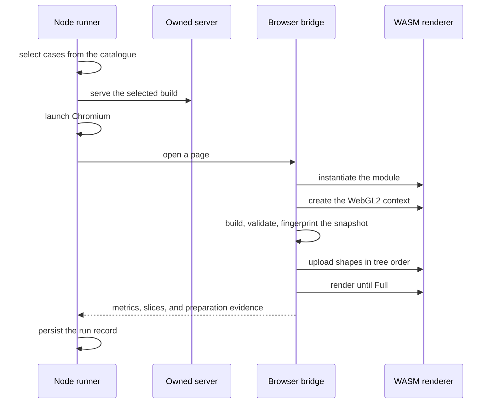
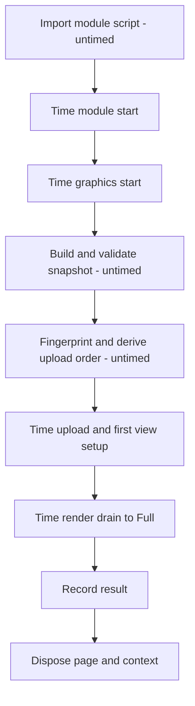

# WASM renderer benchmarks

The renderer benchmark suite measures the Penpot WASM renderer in Chromium. It
provides means to declare parameterized scenes, then render them on a browser
process, recording how long each of several phases take. It can measure "cold"
starts, "warm" interactions like pan and zoom, and compare runs with different
renderer builds.

| 💡 Jump to [How to run](#how-to-run) below for usage instructions. |
| ------------------------------------------------------------------ |

The suite has three parts:

1. A Node runner controls the experiment. It prepares or reuses a build, selects
   test cases, serves the browser executor, launches the browser, schedules
   "attempts" (since cases can fail), saves results, and prints reports.
2. The browser executes the experiment. It owns the WASM module, graphics
   context, scene snapshot, "upload" (to the renderer), interactions, and
   timing.
3. The reports tool analyses saved records. It runs in Node or the browser
   without loading the renderer.

## Contents

- [Main concepts](#main-concepts)
- [Architecture](#architecture)
- [Workloads](#workloads)
- [Measurement](#measurement)
- [Results and reports](#results-and-reports)
- [A/B feature experiments](#ab-feature-experiments)
- [How to run](#how-to-run)
- [Unit tests](#unit-tests)
- [Scope and limitations](#scope-and-limitations)
- [Repository map](#repository-map)
- [Further reading](#further-reading)

## Main concepts

### Workload

- **Renderer**: the Rust Skia renderer compiled to WebAssembly. It owns shape
  storage, tiles, caches, and the WebGL2 graphics state for one canvas.
- **Module**: one instantiated copy of the renderer. The browser creates a
  module per prepared page and releases it with the page.
- **Graphics context**: the WebGL2 context and renderer state bound to one
  canvas. A benchmark _case_ can use either a fresh or a reused context.
- **Scene**: a recipe that produces a starting set of shapes. A scene has an
  id, a closed parameter schema, and a builder function. This function is given
  a random seed and returns a _snapshot_. Scenes can be **procedural**, or
  **captured**. The former build shapes from code, parameters, and a random
  seed, whereas the latter render a page exported from Penpot.
- **Scene snapshot**: the concrete shapes a run renders. This is only static
  data, camera movement and other interactions belong to a **case**.
- **Master seed**: the initial seed for the run, supplied on the command line.
  It defaults to 42 and accepts a 32-bit unsigned integer.
- **Seed**: a 32-bit integer derived from the master seed, scene id, and
  canonical parameters. The seed makes a scene reproducible. Load, pan, and
  zoom cases for the same scene and parameters share one seed.
- **Scene builder**: the construction API used inside a scene. It provides basic
  shapes (`rect`, `path`, `circle`, `frame`, `group`, and `bool`) constructors,
  and a (hopefully) self-explanatory API.
- **Reference**: a label that a scene attaches to a shape during construction.
  A case operation uses references to find shapes it needs.
- **Case**: a scene plus its execution settings: parameters, base view, context
  policy, completion rule, optional operation settings, and a run function. A
  case is the unit that is measured.
- **Operation**: the work a case performs during one attempt, written as a
  function that runs in the browser. The function receives a runtime context
  with the scene, module, view, clock, frame scheduler, and renderer hooks.
  Standard operations load, pan, and zoom.
- **Case descriptor**: What gets sent to the browser. It contains the case id,
  scene, derived seed, parameters, view, context policy, completion rule, batch
  size, preparation settings, and operation settings. Any functions are removed.
- **Catalogue**: the compiled list of case descriptors and scene declarations
  for one build. Node reads the catalogue to select cases. The browser executor
  contains the same declarations and looks up the run function by case id.
- **Fingerprint**: SHA-256 digest of the validated starting snapshot. A
  comparison checks it to establish equal starting scene content.

### Execution

- **Build**: one compiled renderer plus the matching catalogue and browser
  executor. A build id ties the three artefacts together, and the runner rejects
  a mismatch.
- **Retained build**: a ready build that the suite stores under the managed
  build directory and later runs can reuse without recompiling.
- **Fresh case**: a case with `:context :fresh`. Each attempt gets a new page,
  module, graphics context, and upload.
- **Warm case**: a case with `:context :reuse`. One page, module, graphics
  context, snapshot, and upload serve all attempts of the case.
- **Preparation**: the untimed setup for one measured context. It covers module
  instantiation, WebGL context creation, scene build, snapshot validation,
  fingerprinting, upload-order derivation, and upload. A warm preparation also
  restores the starting view and drains to `Full`. One page owns one
  preparation.
- **Attempt**: one execution of a case against a preparation. An attempt
  records one outcome, one set of metrics, and a raw trace. A failed attempt
  still consumes its allocated slot.
- **Warmup**: an attempt that runs the case before measured attempts to warm
  caches and stabilize the page. The run records warmups but excludes them from
  statistics.
- **Repetition**: a measured attempt. A case has a fixed number of repetitions
  chosen before the run.
- **Run**: a set of attempts over selected cases. A run owns the browser
  processes it starts, fixes warmup and repetition counts, records failures in
  chronological order, and performs no hidden retries.
- **Run record**: the saved evidence for one run: plan, build and environment
  provenance, preparations, attempts, metrics, traces, failures, remaining
  slots, and termination. The runner stores it as a data file validated by a
  schema.
- **Bridge**: the object that runs in the browser, receives plain requests from
  Node, owns the page's renderer context, runs preparations and attempts, and
  returns plain results.
- **Runner**: the Node command line interface that builds or reuses a build,
  selects cases, serves the build, launches Chromium, runs attempts, saves
  records, and prints reports.
- **Measurement**: a timed phase. The suite times module start, graphics start,
  upload, first render, and warm interaction separately. Each measurement
  records its value, unit, and basis. The basis says whether the value covers a
  whole attempt or averages a number of inner calls.
- **Slice**: one renderer call record inside an attempt: timestamp, flags,
  frame type, and call duration. Slices are raw evidence. They are not
  independent observations.
- **Frame type**: the completion signal returned by one renderer call. `None`
  means no frame; `Partial` means visible work remains; `Full` means the
  renderer finished the current request; `ViewportReady` means the visible
  viewport was submitted while work outside the viewport may remain.
- **Tile**: a unit of renderer work with a fixed size. A logical tile covers
  512 document units. The renderer caches rendered tiles in a texture atlas.
- **Atlas**: a GPU texture that stores many tiles or a document-space preview.
  Atlases let warm pan and zoom present cached pixels before new tiles finish.

### Results

- **Report**: the statistics and tables computed from one or more run records.
  Reports run in Node or the browser and do not load the renderer.
- **Comparison**: an offline analysis of two saved run records. It pairs cases,
  checks compatibility, and reports changes for each metric with intervals.
- **A/B comparison**: a comparison of two runs that differ by one renderer
  feature. The feature is off in one run and on in the other.
- **Permission**: In principle, only run records with equal builds and equal
  scenes are comparable. Because one sometimes needs to override this strict
  requirement, permissions allow build environment or scene differences in a
  comparison.
- **Termination**: the final state of a run: completed, failed, incomplete, or
  interrupted.

### Feature experiments

- **Feature**: a switch at compile time in the renderer's Cargo manifest.
- **Feature configuration**: the set of Cargo features enabled for one renderer
  build.
- **Feature comparison**: all on and off combinations of the requested features.
  `N` requested features produce `2^N` configurations.
- **Edge**: two configurations that differ in exactly one feature, compared from
  the configuration with the feature off to the configuration with the feature
  on. A comparison with `N` features has `N * 2^(N-1)` edges.
- **Edge comparison**: the comparison record for one edge, stored with the
  feature comparison.
- **Feature-comparison record**: the saved plan, configurations, runs, edges,
  failures, and termination for one A/B experiment.

## Architecture

### Components

The Node runner owns everything outside the page:

- it prepares or loads a build;
- it reads the compiled catalogue and selects cases;
- it serves the selected build from an owned loopback server;
- it launches Chromium and creates pages;
- it schedules warmups and measured attempts;
- it records preparations, attempts, failures, and termination;
- it writes the run record after every material change;
- it asks the shared report code for the terminal summary.

The browser bridge owns everything inside the page:

- it validates a request before claiming the page;
- it imports the renderer module and creates the canvas and WebGL2 context;
- it builds, validates, fingerprints, orders, and uploads the scene;
- it restores the starting view outside timing for warm cases;
- it runs the case operation and times the requested phases;
- it returns plain data and disposes the context when asked.

The shared reporting code owns analysis:

- it normalizes run records into summaries;
- it computes statistics and intervals for each metric;
- it pairs saved cases and checks compatibility;
- it formats run summaries, comparisons, and feature-comparison edge reports;
- it imports no browser, server, or renderer code.

### End-to-end path



The node runner saves the initial plan before it starts a browser, and updates
the run record after each preparation and attempt, and at termination. Reports
are build from these saved records later.

### Builds and catalogues

A build has three artefacts that must agree:

- the renderer module;
- the case catalogue compiled for Node;
- the browser executor and its page.

Preparation compiles the renderer in release mode with Cargo, then compiles the
catalogue and browser executor with the same build _id_, tying the three artefacts
together. The runner checks the id before case collection and when a page starts,
and rejects a mismatch.

An ordinary measurement build uses the renderer's default cargo feature set. A
feature experiment may enable selected functional features. Both kinds of
measurement build should exclude diagnostic features such as `stats`, `profile`,
`profile-macros`, and `profile-raf`. The build checks that we are in release
mode, the optimization level, and disabled profiling marks.

The build record also captures a fixed list of environment values that Cargo
receives, such as compiler, target, and Emscripten settings. Note that it only
records the environment supplied to Cargo via a whitelist. It's not a full
environment dump, and it does not certify a hermetic build.

Builds are saved under `target/performance/render-wasm/builds/<id>/`. The
manifest records the build id, status, functional settings, Git provenance, and
build facts. An experiment run can select a retained build with `--build <id>`,
but a run without `--build` always prepares a new one.

A manual build can select Cargo features with `--features`, but `--build` cannot
be combined with feature selection.

We use the same locks as the main build system to ensure that two preparations
do not run concurrently in the same checkout.

### Browser host

The runner serves the selected build directory from `127.0.0.1` on an allocated
port.

The runner launches headless Chromium with Playwright and owns the browser
process it starts. Cases run serially. A fresh case gets a new page and context
for each preparation. A warm case keeps one page and context for all of its
attempts.

The runner bounds every phase with a deadline. When a page stalls past its
deadline, Node stops the browser process and records the failure. The browser
bridge also checks for context loss, expired deadlines, and stale work from an
earlier page before and after asynchronous work.

Clean-up closes the page, then the browser, then the server. The runner deletes
a build selected with `--remove` only after the final run record is saved.

## Workloads

### Declaring a scene

A scene declaration names an id, a description, a closed parameter schema, and a
builder function. The builder runs inside a seeded scope. Random values come
from one generator owned by that scope, so the same recipe, parameters, and seed
produce the same snapshot.

```clojure
(defscene :rects
  {:description "Seeded rectangles with translucent fills and centered strokes"
   :params-schema schema:params}
  [params]
  (scene {:seed (:seed params)
          :root {:x 0 :y 0 :width (:width params) :height (:height params)}
          :defaults {:rect {:x (gen-int 0 (:width params))
                            :y (gen-int 0 (:height params))
                            :width (gen-int 20 100)
                            :height (gen-int 20 100)
                            :fills (gen-vector (gen-fill))}}}
    (doseq [_ (range (:count params))]
      (rect))))
```

Scene scopes do not nest. Ordinary `let`, `doseq`, and functions defined outside
the scope work inside the body. Each shape constructor accepts an optional label
or a label plus attributes. Attributes override generated defaults by key.
Labels must be keywords or vectors and must be unique within the snapshot.

Containers follow the same pattern:

- `frame` keeps its authored `:x`, `:y`, `:width`, and `:height`.
- `group` derives bounds from its children. A masked group uses its first child
  as the mask.
- `bool` derives content and bounds from its children with the standard path
  engine. It requires a boolean operation type and cannot contain frames.

### Declaring a case

A case id uses the scene namespace. The `defcase` form derives the scene from
that namespace and attaches the run function.

```clojure
(defcase :rects/pan
  {:params default-params
   :view {:scale 1 :x 0 :y 0}
   :context :reuse
   :completion :render-full
   :operation {:steps 20 :dx 200 :dy 0 :settle-ms 100}}
  [rtx]
  (camera/pan! rtx))
```

The case declares:

- `:params`: scene parameters. Collection validates them against the scene's
  closed schema.
- `:view`: the starting camera, with an optional viewport override. The default
  viewport is 1920 by 1080 at device pixel ratio 2.
- `:context`: `:fresh` creates a page, module, and context per attempt.
  `:reuse` keeps one page, module, context, snapshot, and upload for all
  attempts of the case.
- `:completion`: the declared completion rule, `:call`, `:await`, or
  `:render-full`. The standard load body drains to `Full`; the standard pan and
  zoom bodies finish a camera session with a final `Full` drain.
- `:operation`: settings read by the operation body.
- `:batch-size` and `:preparation`: execution settings recorded in the
  descriptor and checked by comparisons. A batch size groups inner calls inside
  one attempt; a repetition is a separate attempt. Standard load, pan, and zoom
  cases run one call per attempt.

### Case collection and seeds

Node collects cases from the compiled catalogue. Collection loads every
declaration, validates every scene and case, derives the scene seed, projects
the case to plain data, and checks that the descriptor survives a serialization
round trip. The process does not build shapes, start a browser, or initialize
the renderer.

The scene seed depends only on the master seed, the scene id, and the canonical
parameters. It does not depend on the case id, collection order, operation
body, attempt count, or feature configuration. This keeps load, pan, and zoom
cases on the same scene content and keeps A/B configurations comparable.

A filter selects cases by a substring of the case id. An empty selection is an
error. Declarations outside the filter are still validated.

### Snapshots and upload order

The snapshot contract requires the canonical root frame, shape ids that match
their object keys, consistent child and parent links, a tree that reaches every
shape from the root, and references that point at present shapes. Validation
runs before any timer starts.

The browser derives upload order from the snapshot and does not store it in the
snapshot. The root comes first, then descendants in the order of each shape's
child list. The browser computes the order and the fingerprint before the upload
clock starts. The upload uses the same batch serializer as the editor, with
structure, fill, and stroke data batched and path and SVG attributes handled per
shape.

### Some example scenes

| Scene   | Content                                                                 | Cases           |
| ------- | ----------------------------------------------------------------------- | --------------- |
| `rects` | 1000 rectangles with random size, translucent fills, strokes, and radii | load, pan, zoom |
| `paths` | 1000 curved paths with fills and strokes                                | load, pan, zoom |
| `plus`  | 1000 plus signs made from two open line subpaths                        | load, pan, zoom |
| `masks` | 24 masked groups, each with a circle mask and 8 striped rectangles      | load, pan, zoom |

A load case renders a fresh scene and times module start, graphics start,
upload, and the first render to `Full`. A pan or zoom case prepares the scene
once, restores the starting view outside timing for each attempt, then times a
camera session. The standard camera sessions use 20 view updates and a 100 ms
settle wait. Pan and zoom parameters vary by scene.

## Measurement

### Preparation and measurement boundaries

The suite keeps slow setup out of timed code. This ties the numbers to renderer
work instead of test code.

Outside timers:

- scene build, snapshot validation, and fingerprinting;
- upload order derivation;
- request and result serialization;
- validation, logging, and screenshots;
- module script import;
- camera restore and the drain that prepares a warm case.

Inside timers:

- module instantiation;
- graphics context creation and initial size synchronization;
- shape batch upload, including the loading lifecycle and first view setup;
- the render drain to `Full`;
- for warm cases, the camera session: view updates, cached previews, settling,
  ending the interaction, and the final drain.

### Lifecycle of a fresh load



The module script import is untimed because the browser loads it once per page.
Module instantiation starts a new renderer state. Graphics start creates the
WebGL2 context and synchronizes the drawing buffer. Upload covers the loading
lifecycle, batch serialization, and tile preparation. The first render clock
starts after upload ends.

### Warm interactions

A warm case owns one prepared page. Before each attempt, the browser restores
the case's starting view and drains to `Full` outside timing. The operation then
runs a camera session:

1. start the camera interaction;
2. for each view update, wait for the next animation frame, apply the view, and
   present cached pixels;
3. wait for the settle interval;
4. end the camera interaction;
5. render until `Full`.

A pure pan can reuse cached textures while it updates which tiles are visible.
A zoom rebuilds and invalidates tile textures. The suite keeps the 100 ms settle
interval and records the requested and actual waits separately from renderer
work. The final drain includes the end of the interaction; the run also records
that call's own duration.

### Slices and metrics

The browser returns raw evidence for each attempt. A fresh attempt also reports
`module-init-ms`, `graphics-init-ms`, and `upload-ms` from preparation.

A fresh attempt reports one drain:

- `slices`: one record per renderer call with `timestamp`, `flags`,
  `frame-type`, and `duration-ms`;
- `viewport-ready-ms`: the first `ViewportReady` or `Full` completion from the
  drain origin;
- `full-ms`: the `Full` completion from the drain origin;
- `first-render-ms`: the single first-render metric for a fresh case.

A warm attempt reports the camera session and the final drain:

- `cached-slices`: one record per gesture frame with `timestamp`,
  `duration-ms` for the cached-preview call, and `view-and-preview-ms` for the
  view update plus preview call;
- `slices`: the final drain, with the same shape as a fresh drain;
- `interact-ms`: the whole camera session, from before the interaction starts
  through the final `Full`;
- `active-ms`: from before the interaction starts to after the last cached
  preview, or after an authored pause that follows it;
- `settling-requested-ms` and `settling-actual-ms`: the declared and observed
  settle spans;
- `set-view-end-ms`: the call that ends the interaction, on its own clock;
- `time-to-viewport-ready-ms` and `time-to-full-ms`: the final drain
  boundaries;
- `last-input-to-full-ms`: from before the last view update to after the final
  drain resolves.

Both kinds of attempt report `renderer-call-total-ms`, the sum of the renderer
call durations, computed after timing.

A metric names its unit, semantics, basis, and zero policy. A batch average
declares its call count, but one attempt still supplies one observation. Raw
slices keep zero durations and non-finite values; the metric layer marks values
that cannot supply an observation.

### What completion means

The renderer finishes in tile budgets. One renderer call returns a frame type,
and the caller continues while the renderer reports `Partial` or
`ViewportReady`. The run completes when a call returns `Full`. `None` or an
unknown value fails the attempt.

| Value | Frame type      | Meaning                                                        |
| ----: | --------------- | -------------------------------------------------------------- |
|     0 | `None`          | no frame                                                       |
|     1 | `Partial`       | visible work remains                                           |
|     2 | `Full`          | the renderer finished the current request                      |
|     3 | `ViewportReady` | the visible viewport was submitted; work outside it may remain |

`Full` is a renderer submission boundary. It does not mean that the GPU has
finished or that pixels are visible. Skia and WebGL submit commands without
waiting for completion, and the suite has no signal for GPU completion or
displayed pixels. A call duration measures synchronous work inside the renderer
call plus any driver stall that happens on the calling thread.

For scheduled calls, the browser passes the timestamp of the animation frame.
For immediate calls, it reads the clock. Each slice records its timestamp so
that call sequences can be reconstructed.

### Graphics environment

The benchmark uses WebGL2 with `antialias=false`, `depth=true`, `stencil=true`,
`alpha=true`, and `preserveDrawingBuffer=true`. The default viewport is 1920 by
1080 at device pixel ratio 2. The preparation records the effective CSS size,
drawing-buffer size, device pixel ratio, context attributes, renderer and vendor
strings, and a software rendering warning.

Benchmarks run inside the Linux development container. Start it with
`./manage.sh run-devenv --gpu` to enable hardware access. This sets
`PENPOT_GPU=1`; the runner then selects ANGLE Vulkan, and `pnpm run render-bench`
starts Xvfb to supply the display that hardware rendering needs in the container.

`--require-gpu` makes `run` and `ab` require hardware WebGL2. The command first
checks for `PENPOT_GPU=1`, before builds, catalogue checks, or output allocation.
After each preparation returns, the runner checks its existing
`:effective-graphics` metadata before executing attempts. It requires WebGL2,
usable vendor and renderer identities, and `:software false`. A rejected
preparation aborts the run with exit 1 and stops later A/B configurations. The
record retains the preparation and graphics failure evidence, and leaves pending
attempt slots unattempted. The failure names the observed renderer and the
commands needed to enable GPU access. `ab --dry-run` skips these GPU checks.

Each preparation records the graphics identity of its own context. The run stores
the GPU policy and environment signal under diagnostics. Default runs allow
SwiftShader fallback and warn when they record software
rendering. Comparisons check effective graphics settings and resolved launch
arguments. Comparing hardware and software runs requires
`--allow-all-differences`: whether that comparison needs a narrower permission
is still an open question.

## Results and reports

### Run record

A run record contains:

- the plan: selected case descriptors, warmup count, repetition count, and
  timeout policy;
- metadata: Git revision and dirty flag, build facts, environment, and diagnostics;
- the resolved analysis settings;
- preparations in chronological order;
- attempts in chronological order, each with its case, preparation, outcome,
  metrics, trace, and failure evidence;
- remaining slots for each case;
- the termination reason.

A preparation records its case, fingerprint, effective graphics, and setup
diagnostics. An attempt records one outcome which can have some invalid or
absent metrics due to failures. We try to retain trace evidence after a failure.

### Failures and termination

A failed attempt still consumes its allocated slot. A fresh preparation failure
records a failed attempt and consumes the slot. A warm preparation failure or a
warm attempt failure releases the prepared page and context and leaves that
case's remaining slots unattempted. A browser or page failure closes the browser
it started, abandons the current case, and starts a new browser for the next
case when possible. The runner performs no hidden retries and no adaptive
stopping.

A run terminates in one of four states:

- **completed**: every allocated slot was attempted and every attempt completed.
- **failed**: every allocated slot was attempted and at least one attempt
  failed.
- **incomplete**: slots remain because a preparation, browser, or storage
  failure stopped the case.
- **interrupted**: `SIGINT` or `SIGTERM` stopped the run.

The runner persists partial records before it exits. Exit status is
authoritative; a saved record alone does not prove success.

### Summaries

A summary reports, for each case and metric:

- the observed mean, median, minimum, maximum, sample standard deviation, and
  median absolute deviation;
- a bootstrap confidence interval for the median. The interval comes from
  repeated resampling of the observed attempts;
- observed p95 and p99 values, the 95th and 99th percentile durations, when the
  sample is large enough;
- counts in the valid, invalid, absent, failed, unattempted, and warmup
  categories;
- the definitions and units of the metric.

Warmups and wholly failed attempts supply no observations. A completed attempt
can supply a valid value for one metric and an invalid value for another. The
report suppresses pooled estimates when valid observations use different metric
definitions.

The default analysis settings are:

| Setting     | Default      |
| ----------- | ------------ |
| Draws       | 2000         |
| Seed        | `0x70656e70` |
| Confidence  | 0.95         |
| Minimum CI  | 10           |
| Minimum p95 | 100          |
| Minimum p99 | 500          |

The run records draw count, seed, confidence, and minimum counts, and a report
can override them at analysis time. An estimate that cannot be computed keeps a
reason and, when applicable, the minimum count it needs.

The intervals are exploratory and conditional on the observed attempts.
Attempts within one run share evolving caches, so they are not independent
samples from a stable process. Repeated whole runs are the way to confirm a
finding.

### Comparisons

A comparison pairs saved cases by identical case id unless `--cases A,B`
fixes the selection to single baseline = A, candidate = B.

By default, a comparison requires equal:

- scene identity, scene seed, and scene parameters;
- starting-snapshot fingerprints;
- view, context policy, completion rule, batch size, preparation settings, and
  operation settings;
- effective graphics settings and runtime environment;
- build mode, effective features, instrumentation settings, and recorded build
  environment;
- warmup count, timeout policy, and metric definitions.

Git revision, dirty state, run ids, timestamps, and each run's saved analysis
defaults are provenance. They do not block pairing.

The comparison reports absolute and percentage median changes, with a bootstrap
interval for each change. A zero baseline suppresses a percentage change. The
comparison leaves a metric with differing definitions out unless the
all-differences permission allows raw values.

### Comparison permissions

The comparison records compatibility differences and never hides them. A
permission acknowledges a class of differences and labels each acknowledged
mismatch with the rule that allowed it.

- `--allow-build-differences` acknowledges recorded build settings, effective
  features, instrumentation, and the recorded build environment. Runtime
  environment, graphics, operation settings, and metric definitions stay
  strict.
- `--allow-scene-differences` acknowledges scene identity, scene seed, scene
  parameters, and differences in fingerprint content. Execution settings stay
  strict. Missing or varying fingerprint evidence still needs the
  all-differences permission.
- `--allow-all-differences` acknowledges every compatibility difference,
  including mixed metric definitions. The report compares valid raw values
  without converting units. Malformed records and unusable measurements remain
  unusable.

Build and scene permissions combine by union. All-differences includes both.
A report shows the selected permissions, every recorded difference, and the
rule that acknowledged it. Timing values never determine the exit status.

## A/B feature experiments

An A/B experiment answers one question: how do the selected cases behave when a
renderer feature is off versus on, with everything else held constant?

The `ab` command takes the requested features, plans the configurations, builds
every configuration, runs every configuration, and compares every "edge".

### Planning

A feature configuration is a set of enabled Cargo features. The planner:

1. normalizes the requested names by trimming, deduplicating, and sorting them;
2. validates them against the renderer manifest with Cargo metadata;
3. requires an empty Cargo default feature set, so each configuration states
   its features explicitly;
4. rejects diagnostic features used for profiling or statistics;
5. orders the configurations in reflected Gray order, so adjacent
   configurations differ by one feature, with the first requested feature as the
   most significant bit;
6. emits every pair of configurations that differ in exactly one feature, from
   the configuration with that feature off to the configuration with it on.

The command requires at least one requested feature. For `N` features, the
comparison has `2^N` configurations and `N * 2^(N-1)` edges. The planner
compares each edge once, not once per execution order. For features
`[a, b]`, the configurations are `00, 01, 11, 10` and the edges are:

```text
00 -> 10 : a
00 -> 01 : b
01 -> 11 : a
10 -> 11 : b
```

`--max-features` accepts 1 through 6 and defaults to 3. The command requires
`--confirm` when the comparison has more than 8 configurations or when the
filter selects every case. `--dry-run` prints the features, configurations,
edges, selected case count, and budgets without creating a comparison home,
compiling, or launching a browser.

### Running a feature comparison

Every configuration gets its own build, catalogue, browser executor, server,
browser, and run. Each configuration runs and cleans up before the next one
starts. The configurations share the selected cases and their seeds, parameters,
views, operations, budgets, preparation settings, and batch sizes. Collection
checks each configuration's catalogue identity and requires the same selected
case
descriptors in the same order.

```bash
pnpm run build:renderer-benchmarks:runner

pnpm run render-bench -- ab \
  --features <feature-a>,<feature-b> \
  --filter rects/load \
  --warmups 3 --repetitions 10
```

The feature names must exist in the renderer manifest. Placeholders appear here
because the manifest decides which features are available.

A configuration that records attempts but fails does not stop the comparison.
Its failures and remaining slots are preserved. A build failure, a catalogue
identity failure, or a run with zero attempts stops scheduling later
configurations; those configurations are recorded as unattempted with a reason.
`SIGINT` and `SIGTERM` save the available state and return 130 or 143.

### Feature-comparison output

The default home is
`target/performance/render-wasm/feature-comparisons/<ab-id>/`. It contains:

```text
feature-comparison.transit             plan, progress, edges, termination
feature-comparison.log                 comparison progress and diagnostics
configs/<slug>/run.transit             the configuration's run record
configs/<slug>/run.log                 the configuration's log
configs/<slug>/*.png                   optional screenshots
comparisons/<from>__<to>.transit       one edge comparison
```

The feature-comparison record stores the normalized options, comparison
permissions, selected cases, configuration order, requested and effective
features, build and run references, edges, failures, and interpretation
warnings. The runner validates the record with a schema and writes it
atomically. It writes the initial plan before the first build and updates the
record after each configuration, after each edge, and at termination. The
command prints `Comparison <id>` and `Output <absolute path>` on stdout before
the first build, then `Status <status>` at termination. Progress and failures
go to stderr. Each configuration has its own build and run log.

### Edge comparisons

An edge comparison uses the ordinary comparison path. It automatically
acknowledges one difference: the effective feature change that matches the
planner's evidence. The evidence records the requested feature, both effective
feature sets, and the added and removed features. It also requires the two
configurations' requested feature selections to differ only by the requested
toggle and to record the same default-feature policy. If the saved sets do not
match that evidence, the difference remains unacknowledged.

The comparison record also carries the edge context: the source and target
configuration slugs and the expected feature facts. An edge is analysed when
both endpoint records exist, even if one run recorded failed attempts. A missing
endpoint or an analysis error remains an explicit edge outcome. An edge that
retains an unacknowledged difference keeps its saved report, is marked failed,
and makes the invocation exit 1.

Other build differences remain subject to `--allow-build-differences`. Scene
differences remain subject to `--allow-scene-differences`. Operation, view,
context, preparation, completion, batch size, graphics, runtime environment, and
metric-definition differences stay strict unless `--allow-all-differences` is
selected. If the two configurations report the same effective feature set, the
edge remains in the comparison and is labelled with that fact. The suite does
not
infer a performance effect from the requested toggle alone.

The command returns 0 when every configuration completes, every edge analysis
finishes, and every difference is acknowledged. It returns 1 for execution,
persistence, or analysis failures, including unacknowledged differences. Edge
reports show raw times and the usual statistics. They describe the observed
difference; they do not prove that the feature caused it.

## How to run

Run these commands from `frontend/` inside the development container with
dependencies and Playwright Chromium installed. Keep renderer watchers stopped
until preparation finishes.

The literal `--` after `render-bench` is required to forward the command and its
arguments through the shell wrapper.

Build the runner and its command module:

```bash
pnpm run build:renderer-benchmarks:runner
```

Run one case with one measured attempt:

```bash
pnpm run render-bench -- run \
  --filter paths/pan --seed 42 --warmups 0 --repetitions 1 --screenshots
```

Prepare a build once and reuse it:

```bash
pnpm run render-bench -- build
pnpm run render-bench -- run --build <build-id>
```

Run a selection with the default sampling:

```bash
pnpm run render-bench -- run --filter rects
```

Require hardware rendering for rectangle load, pan, and zoom in a GPU container:

```bash
pnpm run render-bench -- run --filter rects --require-gpu
```

For a functional smoke check, add `--warmups 0 --repetitions 1`. A successful
run renders the scenes through `Full` and saves the vendor and renderer strings
with `:software false` in each preparation's `:effective-graphics`.

An explicit `--output-dir` must not exist; the runner refuses to overwrite it.
The same rule applies to an A/B feature-comparison home.

Compare two saved runs offline:

```bash
pnpm run render-bench -- compare \
  target/performance/render-wasm/runs/<baseline>/run.transit \
  target/performance/render-wasm/runs/<candidate>/run.transit
```

Allow a difference in build configuration, or compare two given scenes,
irrespective of their differences:

```bash
pnpm run render-bench -- compare \
  target/performance/render-wasm/runs/<baseline>/run.transit \
  target/performance/render-wasm/runs/<candidate>/run.transit \
  --allow-build-differences

pnpm run render-bench -- compare \
  target/performance/render-wasm/runs/<baseline>/run.transit \
  target/performance/render-wasm/runs/<candidate>/run.transit \
  --cases rects/load,paths/load --allow-scene-differences
```

Inspect and clean managed outputs:

```bash
pnpm run render-bench -- purge --only-builds
pnpm run render-bench -- purge --only-runs
pnpm run render-bench -- purge --only-comparisons
```

`purge` removes known build, standalone-run, or feature-comparison outputs. It
keeps the managed directories and unrelated files. The three `--only-*` options
are mutually exclusive; no option selects every category.

The commands write results to stdout:

- `build`: `Build <id>` and `Output <absolute path>` at allocation.
- `run`: `Run <id>` and `Output <absolute path>` at allocation, then a `Report`
  heading and the formatted summary.
- `ab`: `Comparison <id>`, `Output <absolute path>`, and final
  `Status <status>`.
- `compare`: the comparison report.
- Help: usage text. `purge` produces no output on success.

Progress and diagnostics go to stderr. The default shows build phases, case
headings, and attempt progress. `-q` / `--quiet` shows results, warnings, and
errors. `-v` / `--verbose` also shows debug details and raw build output. Quiet
and verbose are mutually exclusive. These options apply to every command.

`--color` forces terminal colours; `--no-color` disables them. Automatic colour
uses a terminal stream when `NO_COLOR` is empty or absent and `TERM` is not
`dumb`. Results and file logs receive no logger colours. Child output is read as
lines with normalized line endings. Verbose terminal output prefixes and dims
these lines; file logs store them without those decorations. Terminal errors
include a bounded log tail when available.

Files receive every log level, including debug output hidden from the console.
Each build writes `build.log`; each A/B comparison writes
`feature-comparison.log`. The default run home is
`target/performance/render-wasm/runs/<run-id>/`, which contains `run.log`,
`run.transit`, and optional screenshots.

Exit 0 means the command completed successfully: a ready build for `build`,
every allocated attempt for `run`, a valid comparison for `compare`, every
configuration and edge for `ab`, and a clean purge for `purge`. Exit 1 means a
failed preparation, a failed attempt, an incomplete run, an invalid selection,
an unacknowledged comparison difference, or a harness failure. Exits 130 and 143
mean interruption by `SIGINT` and `SIGTERM` for `build`, `run` and `ab`. An
interrupted command prints no error for the aborted work; it prints a failed
write of its own record or log.

`--warmups` defaults to 3, `--repetitions` to 10, `--timeout-ms` to 30000,
`--build-timeout-ms` to 300000, and `--startup-timeout-ms` to 30000. The master
seed defaults to 42 and accepts a 32-bit unsigned integer. A filter matches a
substring of the case id.

## Unit tests

Run these commands from `frontend/` inside the development container with
dependencies and Playwright Chromium installed. The benchmark tests use the
`performance-tests` build target and the runner in
`test/performance_tests/render_wasm/runner.cljs`.

Build and run the full suite:

```bash
pnpm run test:renderer-benchmarks
```

Build once, then run the compiled tests:

```bash
pnpm run build:renderer-benchmarks:tests
node target/performance-tests/test.js
```

Focus on one namespace or one test var:

```bash
node target/performance-tests/test.js \
  --focus performance-tests.render-wasm.contracts-test

node target/performance-tests/test.js \
  --focus performance-tests.render-wasm.contracts-test/defscene-registers-metadata-and-build
```

Rebuild the test bundle after changing source or tests. `--focus` accepts one
namespace or one `namespace/test-var`. The runner exits 0 when the selected tests
pass and 1 when they fail.

## Scope and limitations

The suite measures renderer phases inside Chromium exclusively, which means that
the numbers we generate end at the renderer submission boundary. In particular,
we **do not** measure memory, power, frame rate, frame drops, visual
correctness, network, or editor input-to-paint.

In addition, a fresh context starts a new page, module, and WebGL context. The
browser process persists across cases, and the module script import runs before
the module clock, so the measurement is not cold.

Attempts share evolving caches, so bootstrap intervals describe the observations
within a run. Repeat whole runs to assess reproducibility, and judge whether the
observed change matters for the workload.

## Repository map

```text
frontend/performance/benches/render_wasm/
├── browser/          page entry and browser bridge
├── node/             CLI, build preparation, server, browser host, run, artefacts
├── report/           summaries, comparisons, statistics, formatting
├── runtime/          render drain and camera session protocol
├── scenes/           scene recipes and their cases
├── builder.cljc      scene construction
├── declarations.cljc scene and case registry, schemas, seed derivation
├── cases.cljs        case discovery and collection
├── codec.cljs        Transit round-trip validation
├── errors.cljc       failure values and diagnostics
├── feature_plan.cljs feature configurations and comparison edges
├── snapshot.cljs     snapshot validation and upload order
├── fingerprint.cljs  digest of the starting snapshot
├── identity.cljc     build identity and bundle compatibility checks
├── measurement.cljs  metric normalization
├── random.cljs       seeded random generators
├── result.cljs       run, comparison and feature-comparison records
├── README.md         this document
└── REPORTING.md      records, metrics, and statistics

frontend/test/performance_tests/render_wasm/
├── runner.cljs         test entry point, namespace registration, focus selection
├── *_test.cljs         tests for benchmark modules
├── test_helpers.cljs   shared scene-test helpers
└── cli_integration.cjs tests for the CLI through Node

frontend/package.json          build and test commands
frontend/shadow-cljs.edn       benchmark and performance-tests build targets
frontend/src/app/render_wasm/  production renderer wrapper
render-wasm/                   Rust renderer and build
```

## Further reading

- [`REPORTING.md`](REPORTING.md) describes the record schemas, metric entries,
  and statistical calculations in detail. This guide is the source for the
  command line and the A/B workflow.
- [`render-wasm/README.md`](../../../../render-wasm/README.md) and the renderer
  source describe the Rust side.
- [`frontend/src/app/render_wasm/`](../../../src/app/render_wasm/) contains the
  production renderer orchestration whose renderer bindings and upload
  serializers the benchmark shares.
